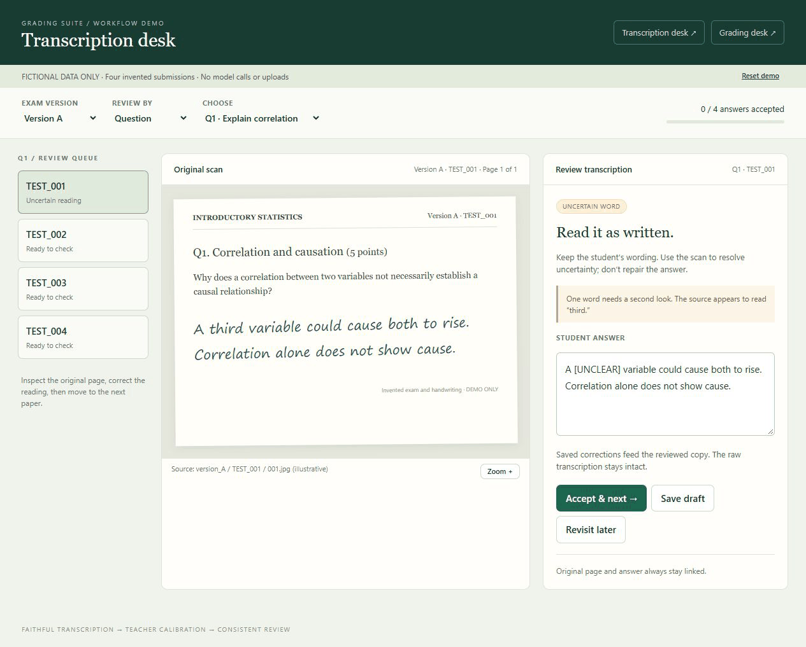
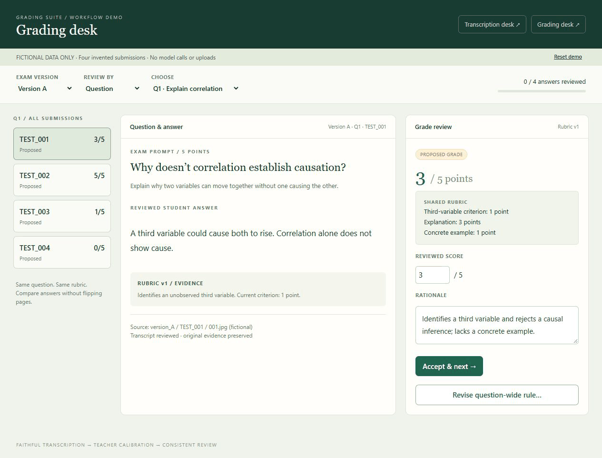

# Grading Suite

### Less page flipping. More consistent grading.

A starter kit for teachers who want Codex or Claude Code to help grade written exams. Scan the papers, check the transcriptions beside the originals, teach the agent your partial-credit judgments, and review the grades in a local web app.

**The big wins:** move through answers without flipping pages, apply the same standard across the class, and revise a rubric once instead of hunting through every paper. Explicit scoring rules can update immediately; changes that require judgment trigger a regrade of every affected answer.

Built from [Don Bowen's exam-grading workflow](https://x.com/DonBowenFinance/status/2118100312129216861). This is a **prompt-first skeleton**, not a prebuilt grading service. Your coding agent builds the review apps around your exam. You remain the grader.

## See the workflow

**Transcription desk:** original page on the left, editable transcription on the right. Correct an uncertain reading, save, and move on.



**Grading desk:** review one question across students, compare reasoning, and apply a shared scoring rule to everyone it affects.



These are working illustrative demos using entirely invented answers and submission IDs, not screenshots of real student work. [Open the interactive demos](docs/demo/README.md), or view the still images: [transcription](docs/media/transcription.png) · [grading](docs/media/grading.png). GIFs animate automatically; the HTML demos are interactive.

## Quick start

1. **Download or clone this repo** into a new folder on your computer. Open that folder in the Codex app, Claude Code, or a coding-agent app that can read local files, inspect images, run code, and build a local web app. No separate AI API key is required by this skeleton; your agent may need its own subscription and permission to install ordinary app dependencies.
2. **Add your materials.** Put the exam as students saw it in `inputs/exams/`, answer keys in `inputs/answer_keys/`, and any existing rubric in `inputs/rubrics/`. Include every version. PDFs, Word files, and Markdown are fine; the agent should create readable working copies while preserving originals.
3. **Scan the tests however you like.** A scanner is great. A phone plus Dropbox or Google Drive also gets photos onto your computer quickly. Put an anonymous test ID on the cover page and page 2, and don't scan the cover page with the student's name, and keep your name-to-ID list outside this folder. Put scans in `inputs/submission_scans/<version>/<test-id>/*.jpg`. Keep pages in capture order. [Folder and page-order details](inputs/submission_scans/README.md).
4. **Tell your agent:**

   ```text
   Use donbowen/grading_suite to help me grade my exam.
   Read AGENTS.md and prompts/00_start_here.md in this folder,
   inspect the materials I added, and guide me through the workflow.
   ```

   If you haven't downloaded the repo yet, add: “Clone https://github.com/donbowen/grading_suite into a new local folder first.” The agent needs access to this repo and your local exam files; a repo name alone does not grant that access.
5. **Review the transcription desk.** The agent transcribes the scans and builds an app so you can compare them side by side. Resolve uncertainties and confirm the reviewed transcriptions before grading.
6. **Calibrate before grading the class.** Grade three exams yourself. Let the agent grade those same papers independently; discuss the differences and revise the rubric. Repeat on three more, preferably including unusual answers and other exam versions. The agent saves your decisions in files, so the workflow doesn't depend on chat memory.
7. **Grade and review.** The agent applies the approved rubric, builds the grading desk, and flags uncertain or inconsistent judgments. Review by question or by student. A rubric revision affects every relevant submission, including ones already reviewed. Recheck changed results, then approve the final export.

The agent should get as far as it can on its own, then ask for the teaching judgments only you can make. A one-shot setup prompt can build the workflow; it cannot replace transcription review or rubric calibration.

## What's included

```text
prompts/                    Ordered prompts for the whole workflow
inputs/
  submission_scans/         Empty scan folders + organization guide
  exams/                   Exam papers as written, by version
  answer_keys/             Authoritative solutions, by version
  rubrics/                 Optional existing scoring guidance
workspace/                 Generated transcripts, rubric, grades, audit trail
apps/                      Review apps your agent will build
exports/                   Teacher-approved outputs
docs/demo/                 Standalone interactive demos; fake data only
docs/media/                README screenshots and GIFs
```

| Step | Prompt |
| --- | --- |
| Start and resume | [00 · Guide the workflow](prompts/00_start_here.md) |
| Inventory versions, pages, questions | [01 · Prepare](prompts/01_prepare.md) |
| Read handwriting without fixing answers | [02 · Transcribe](prompts/02_transcribe.md) |
| Build the side-by-side correction desk | [03 · Transcription review app](prompts/03_transcription_review_app.md) |
| Optional: draft a scoring rubric | [04 · Create rubric](prompts/04_create_rubric.md) |
| Learn the teacher's grading judgments | [05 · Calibrate](prompts/05_calibrate.md) |
| Apply the approved rubric | [06 · Grade](prompts/06_grade.md) |
| Build the grading desk and revise rules | [07 · Grading review app](prompts/07_grading_review_app.md) |
| Find inconsistencies and unresolved issues | [08 · Flag issues](prompts/08_flag_issues.md) |
| Validate, summarize, and export | [09 · Export](prompts/09_export.md) |

## A few practical details

- **Fast review, consistent rules.** Question-by-question review makes similar answers easy to compare. Preserve both individual decisions and class-wide rule changes with an audit trail.
- **Version-aware.** “Question 2” need not mean the same thing on versions A and B. Match by version and question ID; explicitly map equivalent questions before sharing rules.
- **Source-backed.** Every answer points to its original page(s). Missing pages and illegible answers stay unresolved instead of quietly becoming zeros.
- **Teacher-controlled.** AI scores are proposals until you review them. Keep student materials in your private working copy and use tools approved for your institution. Local review apps do not imply that transcription or grading models run locally.
- **Private work stays out of Git by default.** Input contents, generated records, apps, and exports are ignored; only placeholder READMEs are tracked. Don't force-add real submissions or keys to a public fork. The name-to-ID mapping belongs elsewhere.

See [the shared data contract](docs/data-contract.md) for how the prompts fit together. Start a fresh private working folder for each exam.

MIT licensed. Adapt freely.
